<!-- Replace this path with your own SVG banner path -->

---

<table border="0" cellspacing="0" cellpadding="0">
<tr>
<td width="65%" valign="middle">

### Software Developer • AI/ML Enthusiast • Builder

I enjoy turning ideas into useful software from AI-powered tools and developer infrastructure to full-stack products.

Currently exploring **Generative AI, agentic systems, developer tools, and intelligent applications**.

</td>
<td width="35%" align="center" valign="middle">

<!-- Replace this path with your own profile image -->

</td>
</tr>
</table>

## About Me
- CSE undergraduate at **IIT Patna**
- Interested in **Generative AI, LLM applications, AI agents, and ML**
- I like building end-to-end products, reliable backend systems, and tools that improve developer workflows
- Currently learning more about **agent evaluation, system design, and applied AI**
- Open to collaborating on interesting open-source and engineering projects

## Featured Projects

A few things I've been building recently:

<table border="0" cellspacing="0" cellpadding="0">
<tr>
<td width="50%" valign="top">

### [Sahayak](https://github.com/prateekg7/sahayak)

**A voice-first everyday AI assistant**

A modular, privacy-conscious assistant built around **MCP**, designed to connect conversational experiences with useful everyday workflows across productivity, academics, career, and more.

`Python` `FastAPI` `MCP` `PostgreSQL` `Redis`

</td>
<td width="50%" valign="top">

### [DriftGuard](https://github.com/prateekg7/driftguard)

**Keep AI coding-agent context in sync with code**

Detects potentially stale statements in `CLAUDE.md` and `AGENTS.md` after code changes, then proposes small, reviewable updates instead of regenerating context blindly.

`TypeScript` `Node.js` `LLMs` `GitHub Actions`

</td>
</tr>
<tr>
<td width="50%" valign="top">

### [ContextBridge](https://github.com/prateekg7/Context-Bridge)

**Portable context for AI conversations**

Turns ongoing conversations into structured handoffs — preserving goals, decisions, constraints, open threads, and next steps so another AI can continue without starting from scratch.

`TypeScript` `MCP` `LLM Applications`

</td>
<td width="50%" valign="top">

### [Alumni Sangham](https://github.com/prateekg7/Alumni-Sangham)

**An alumni-student network for IIT Patna**

A full-stack community platform for verified profiles, mentorship, referrals, alumni discovery, and community updates.

`React` `Node.js` `Express` `MongoDB`

</td>
</tr>
</table>

## Tech Stack

**Languages**

**AI / ML and Backend**

**Tools and Platforms**

ㅤ
<table border="0" cellspacing="0" cellpadding="0">
<tr>
<td width="55%" align="center" valign="middle">

</td>

<td width="42%" align="center" valign="middle">

</td>
</tr>
</table>

## Connect With Me

